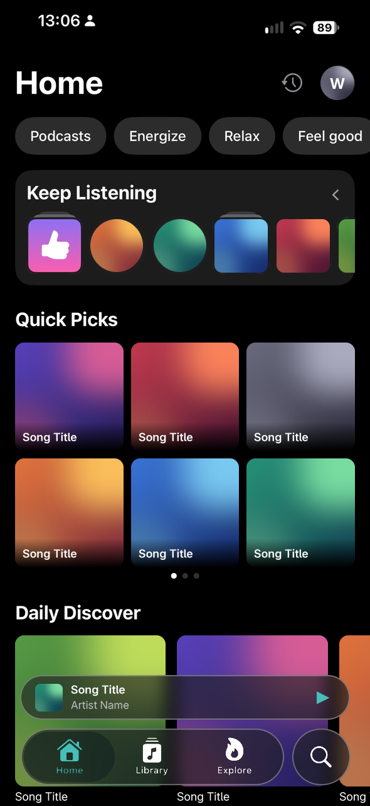
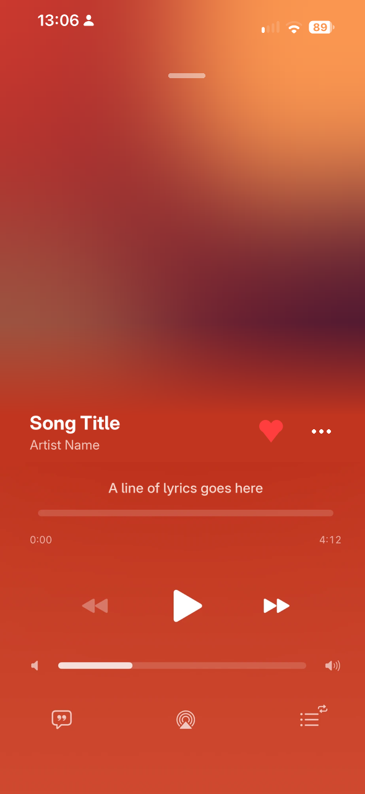
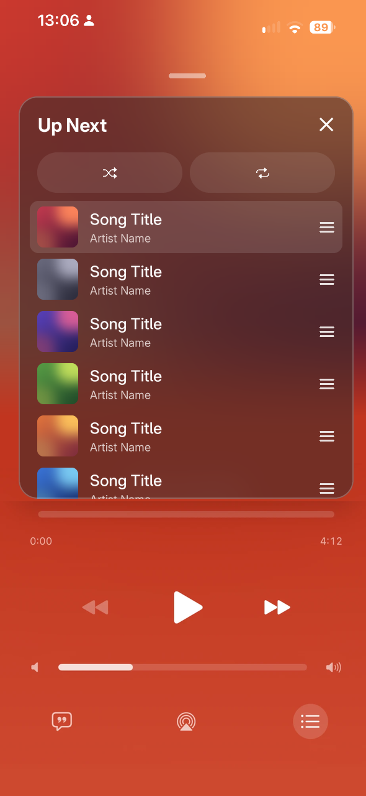

<div align="center">



[](#install)
[](Trop)
[](https://mpv.io)
[](LICENSE.txt)
[](https://github.com/LaskyWolf/WoofMusic/releases)

**A free, open source YouTube Music client for iPhone, written in SwiftUI.**
It plays without ads and mixes songs like a DJ.

&nbsp;
&nbsp;


</div>

## Highlights

| | |
| --- | --- |
| 🎧 **AutoMix** | Beat-matched transitions: the two songs share a tempo and the bass swaps on the bar. |
| 🌊 **Smart Crossfade** | Fades into the next song where the current one winds down. |
| ⬇️ **Real downloads** | Songs, albums and playlists play offline, and a badge marks what is saved across the app. |
| 👤 **Separate accounts** | Each Google account keeps its own library, downloads, history, Recap and linked services. |
| 🧊 **Native iOS 26** | Liquid Glass controls, system menus and zoom transitions, with icons that move when you use them. |

## Features

### Home and Explore
- Your YouTube Music Home feed, which opens on the last saved page while the new one loads
- Keep Listening card: recent songs, albums and playlists as a fanned stack that spreads with a tap
- Quick Picks and the sections built from your own library, also offline
- New albums and singles in Explore: cards tinted with each cover's colours, with a vinyl that slides out and spins while the album plays
- Moods and genres as a looping row of coloured cards

### Playback
- Songs and podcasts from YouTube Music, with no ads
- Equalizer presets with a curve preview
- Play Next queue, song radio and listening history
- Sleep timer with a Clock-style countdown wheel or the end of the song
- AirPlay, a system volume bar and lock screen controls
- Non-music parts skipped with SponsorBlock, which you can turn off

### Library
- Sync of playlists, albums, artists, podcasts and liked songs with your account
- Playlist editing: name and cover in one sheet, synced to YouTube Music
- Downloads with full-size cover art and progress on each row
- Songs that can't be played shown in grey and left out of queues and download counts
- Select many songs to play, queue, like, download or add them to a playlist
- Long-press menus on songs, albums, playlists, artists and Home cards

### Lyrics
- Synced lyrics from Musixmatch, Netease, Kugou, LRCLIB and Genius
- Offset, editing and search

### Accounts and search
- Google sign-in inside the app, with several accounts to switch between
- Search with YouTube Music suggestions, recent searches and sorting
- Incognito mode: searches and plays aren't saved on the iPhone, and songs stay out of your YouTube Music history

### Widgets and integrations
- **Home Screen widgets:** now playing, Quick Picks and monthly stats
- **Last.fm** and **ListenBrainz** scrobbling
- **Discord Rich Presence** (needs the Discord Social SDK, see [below](#discord-social-sdk))
- **Siri and Shortcuts:** "Shuffle my liked songs in Woof Music", play/pause, next song, search and play a song or artist
- **Home Screen quick actions:** Search, Shuffle Liked Songs, Downloads, Resume

### Look
- Custom app icons and accent colours
- Left-handed tab bar option
- VoiceOver support on the player and song rows, and Reduce Motion is respected

## Speed

- Home opens on the last saved page, or on the sections built from your library, before YouTube answers.
- The next song's stream address is loaded while the current one plays, so skipping starts at once.
- Covers of the neighbouring songs load ahead of a swipe.
- Images are held in a memory-limited cache.

## Privacy

- The app has no analytics and no server of its own. It talks to YouTube Music directly.
- SponsorBlock receives the ID of each song you play. Turn off the non-music skip in Settings to stop that.
- Lyrics providers receive the title and artist of songs they look up.
- Last.fm, ListenBrainz and Discord receive what you play only after you connect them.
- The log file stays on the iPhone until you share it from Settings.

## Install

You need iOS 26 or later and a YouTube Music account. This project does not publish IPA files, so you build your own.

1. Fork this repository.
2. Open the **Actions** tab and run the **iPhone Build** workflow.
3. Download the `WoofMusic-iOS` artifact from the finished run. It contains `WoofMusic-<version>.ipa`.
4. Sideload it with a tool that re-signs apps with your Apple ID: AltStore, SideStore, Feather or KravaSign. AltStore PAL is not supported.
5. Open Woof Music and sign in from the top of Settings.

### Build on a Mac

You need Xcode.

```bash
./build_ipa.sh
```

The IPA is written to `build/WoofMusic-<version>.ipa`. The version comes from `MARKETING_VERSION` in the Xcode project.

### Discord Social SDK

Discord Rich Presence uses Discord's Social SDK, a proprietary binary that is not in this repository. Without it the app builds and runs, and Discord login shows an error.

To enable it:
1. Download `DiscordSocialSdk-<version>.zip` (the C++ one) from the Discord Developer Portal.
2. Attach it to a release tagged `discord-sdk` in a **private** repository. A release in a public repository can be downloaded by anyone.
   ```bash
   gh release create discord-sdk --repo <owner>/<private-repo> DiscordSocialSdk-<version>.zip
   ```
3. Create a fine-grained personal access token with read-only **Contents** access to that private repository, then add it and the repository name to this repository's Actions settings:
   ```bash
   gh secret set DISCORD_SDK_TOKEN --repo <owner>/<repo>
   ```
   ```bash
   gh variable set DISCORD_SDK_REPO --repo <owner>/<repo> --body <owner>/<private-repo>
   ```
   The workflow downloads the SDK from there. If it can't, the build continues without it and shows a warning.
4. For a local build, put `discord_partner_sdk.xcframework` in `build/discord/`.

## Account risk

Google can challenge or restrict an account used in an unofficial app. Test with a second account.

## Credits

Woof Music is a fork of [Trop](https://github.com/686udjie/Trop) by 686udjie.

- [SwiftyTube](https://github.com/686udjie/SwiftyTube): Swift InnerTube client for YouTube Music requests, sign-in and session renewal
- [InnerTubeX](https://github.com/MetrolistGroup/innertubex): extended InnerTube API library for Kotlin
- [zemer-cipher](https://github.com/ZemerTeam/zemer-cipher): YouTube cipher deobfuscation and PoToken generation
- [Metrolist](https://github.com/MetrolistGroup/Metrolist): YouTube Music client for Android
- [mpv](https://mpv.io): audio playback
- [SponsorBlock](https://sponsor.ajay.app): community data on non-music segments

## License

[GPLv3](LICENSE.txt), like Trop. Woof Music is not affiliated with, endorsed or sponsored by Google or YouTube.
