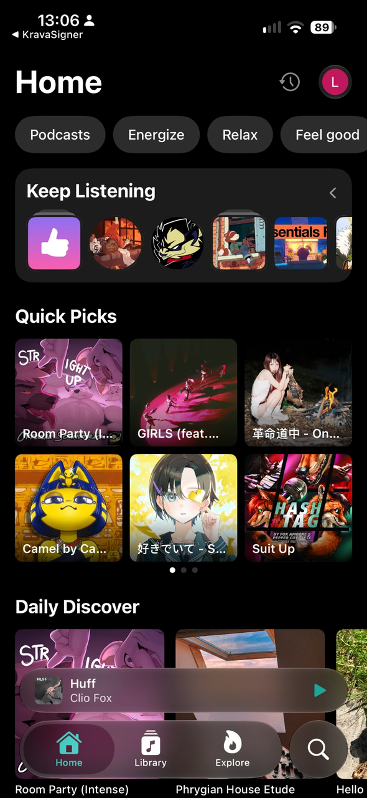
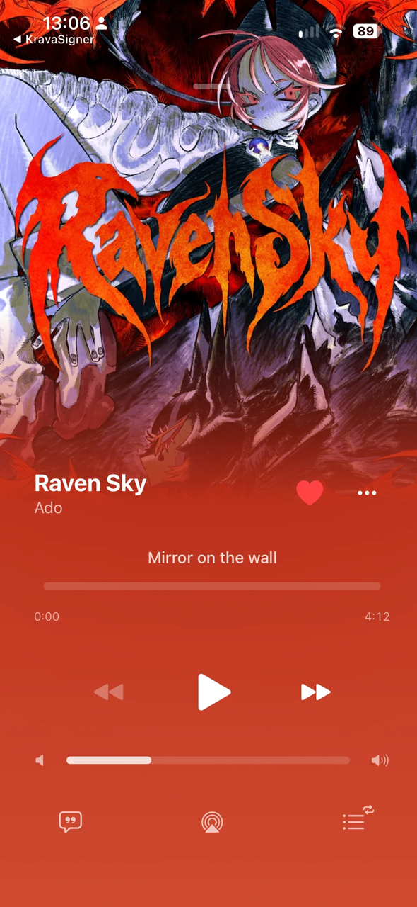
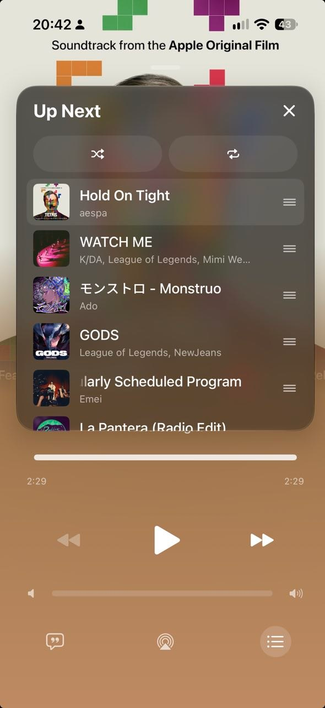

<div align="center">

# Woof Music

**A free, open source YouTube Music client for iPhone.**
No ads, native iOS design, DJ-style transitions.

[](#install)
[](Trop)
[](LICENSE.txt)
[](https://github.com/LaskyWolf/WoofMusic/releases)

&nbsp;
&nbsp;


</div>

## Highlights

| 🎧 **AutoMix** | Beat-matched transitions: matches the tempo of both songs and swaps the bass on the bar. |
| 🌊 **Smart Crossfade** | Fades into the next song where the current one winds down. |
| 🌙 **Sleep timer** | 5 to 60 minutes or the end of the song, with a night-sky animation when it ends. |
| ✅ **Bulk select** | Select many songs and play, queue, like, download or add them to a playlist at once. |

## Features

### Playback
- Stream songs and podcasts from YouTube Music, with no ads
- Equalizer presets with a curve preview
- Play Next queue, song radio and listening history
- Pull down anywhere on the player to close it
- AirPlay and a system volume bar in the player

### Library
- Sync of playlists, albums, artists, podcasts and liked songs with your account
- Playlist editing: name and cover in one sheet, synced to YouTube Music
- Downloads for offline listening, with full-size cover art and progress on each row
- Liked Songs, My Top 100 and Downloads shortcuts at the top of the Library
- Long-press menus on songs, albums, playlists, artists and Home cards

### Lyrics
- Synced lyrics from Musixmatch, Netease, Kugou, LRCLIB and Genius
- Offset, editing and search

### Integrations
- **Last.fm** and **ListenBrainz** scrobbling
- **Discord Rich Presence** (needs the Discord Social SDK, see [below](#discord-social-sdk))
- **Siri and Shortcuts:** "Shuffle my liked songs in Woof Music", play/pause, next song, search and play a song or artist
- **Home Screen quick actions:** Search, Shuffle Liked Songs, Downloads, Resume

### Interface
- Native iOS 26 menus and Liquid Glass controls
- Custom app icons and themes
- Left-handed tab bar option

## Install

You need iOS 26 or later and a YouTube Music account. You sign in through the in-app web view.

1. Get `Music.ipa`: build it yourself (below). Releases do not include an IPA.
2. Sideload it with a tool that re-signs apps with your Apple ID: AltStore, SideStore, Feather or KravaSign. AltStore PAL is not supported.
3. Open Woof Music and sign in from the top of Settings.

## Build

**GitHub Actions (no Mac needed)**
1. Fork this repository.
2. Open the **Actions** tab and run the **iPhone Build** workflow.
3. Download the `Music-iOS` artifact from the finished run. It contains `Music.ipa`.

**macOS with Xcode**

```bash
./build_ipa.sh
```

The IPA is written to `build/Music.ipa`.

### Discord Social SDK

Discord Rich Presence uses Discord's Social SDK, a proprietary binary that is not in this repository. Without it the app builds and runs, and Discord login shows an error.

To enable it:
1. Download `DiscordSocialSdk-<version>.zip` (the C++ one) from the Discord Developer Portal.
2. Attach it to a release tagged `discord-sdk` in a private repository:
   ```bash
   gh release create discord-sdk --repo <owner>/<repo> DiscordSocialSdk-<version>.zip
   ```
   The workflow downloads it from there.
3. For a local build, put `discord_partner_sdk.xcframework` in `build/discord/`.

## Credits

Woof Music is a fork of [Trop](https://github.com/686udjie/Trop) by 686udjie.

- [SwiftyTube](https://github.com/686udjie/SwiftyTube): Swift InnerTube client for YouTube Music requests, sign-in and session renewal
- [InnerTubeX](https://github.com/MetrolistGroup/innertubex): extended InnerTube API library for Kotlin
- [zemer-cipher](https://github.com/ZemerTeam/zemer-cipher): YouTube cipher deobfuscation and PoToken generation
- [Metrolist](https://github.com/MetrolistGroup/Metrolist): YouTube Music client for Android

## License

[GPLv3](LICENSE.txt), like Trop. Woof Music is not affiliated with, endorsed or sponsored by Google or YouTube.
